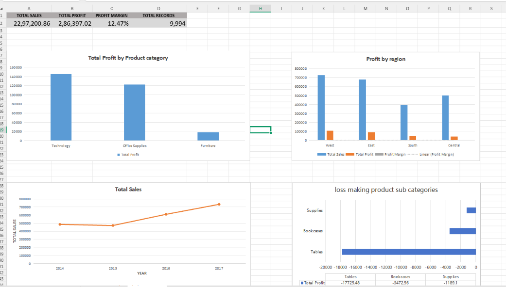

# Sales Profitability Analysis Using SQL

## 1. Project Overview

This project analyzes sales data to understand business profitability and identify product sub-categories that generate losses despite contributing to overall sales.

Using SQL, the project examines sales, profit, and profit margins to uncover areas where the business can improve pricing, discounting, and profitability.

## 2. Business Problem

High sales do not always translate into high profits. Some products may generate substantial revenue but still result in losses due to high costs, discounts, or low profit margins.

The objective of this analysis is to identify loss-making product sub-categories and generate actionable insights to support better business decisions.

## 3. Project Objectives

- Analyze overall sales and profitability.
- Identify loss-making product sub-categories.
- Calculate and compare profit margins.
- Examine product-level and sub-category-level performance.
- Provide data-driven business recommendations.

## 4. Tools and Technologies

- **SQL:** Data analysis, aggregations, calculations, and profitability analysis.
- **Dataset:** Superstore sales dataset.

## 5. Key Business Questions

1. What is the overall sales and profit performance?
2. Which product sub-categories generate losses?
3. Which sub-categories have negative profit margins?
4. How can the business improve profitability?
5. Why should profit margins be considered alongside sales revenue?

## 6. Key Findings

The analysis identified multiple loss-making product sub-categories.

| Sub-Category | Total Sales | Total Profit | Profit Margin |
|---|---:|---:|---:|
| Tables | 206,965.53 | -17,725.48 | -8.56% |
| Bookcases | 114,880.00 | -3,472.56 | -3.02% |
| Supplies | 46,673.00 | -1,189.10 | -2.55% |

These findings show that generating sales does not necessarily mean generating profit. Tables had the largest loss among these sub-categories, making them an important area for further investigation.

## 7. Business Recommendations

- Review discounting practices for loss-making product sub-categories.
- Investigate product costs and pricing to understand negative profit margins.
- Monitor profitability alongside sales when evaluating product performance.
- Identify opportunities to reduce costs and improve margins.
- Regularly review product performance to support informed business decisions.

## 8. Conclusion

This project demonstrates how SQL can be used to analyze business data and identify profitability issues. By examining sales, profit, and profit margins, the analysis provides insights that can help businesses make better pricing, cost-management, and product-performance decisions.

## 9. Skills Demonstrated

- SQL querying and data aggregation
- GROUP BY and aggregate functions
- Profit and profit margin calculations
- Business analysis and problem-solving
- Translating data findings into actionable recommendations

## Dashboard Preview

